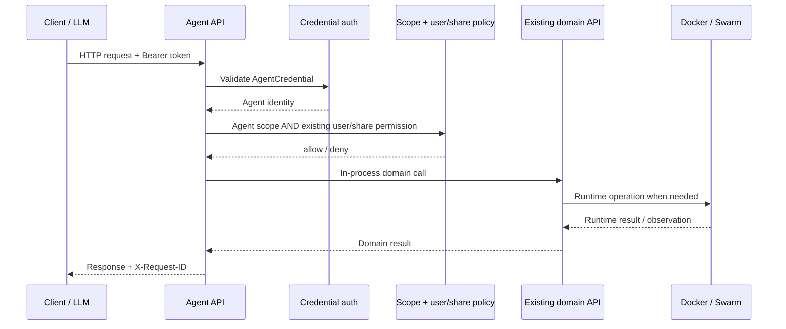
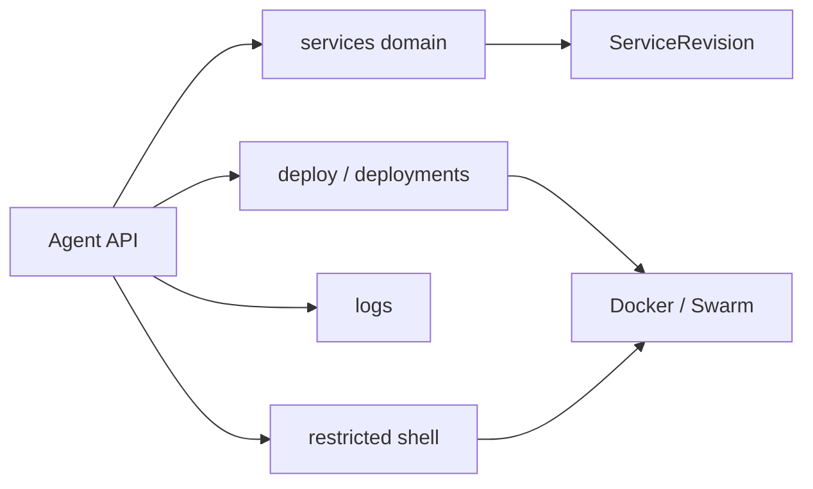

# Agent API reference

The Agent endpoint contract is defined by src/agent/contracts.py. This page documents the complete route matrix plus request parameter conventions. The machine-readable schema remains /agent/v1/openapi.json.

## Request flow



## Common parameters and headers

| Parameter/header | Required | Contract |
|---|---|---|
| `Authorization: Bearer <token>` | Yes except `/auth/exchange` | Persistent Agent access credential. Never log or expose it. |
| `X-Request-ID` | Optional | Request correlation id; server creates one if absent/invalid and returns it. |
| `Idempotency-Key` | Optional by HTTP syntax; used by idempotent mutations | Durable 24-hour replay identity for endpoints marked idempotent. |
| `X-Shell-Token` | Required for shell command/close unless body `token` is supplied | Short-lived credential for one shell session. |

## Pagination

AgentPage collection endpoints accept page and page_size. Default page size is 25; maximum is 100.

## Complete endpoint matrix

Every row below is copied from the centralized endpoint contract. `scopes` are all required. `any_scopes`, when present, adds an OR requirement on top of the required scopes. Therefore the two shell file/tool contracts that list both file scopes in `scopes` still require both scopes; their `any_scopes` entry is currently redundant and documented as such rather than silently changing runtime behavior.

| Method | Endpoint | Path parameters | Required scopes | Any-of scopes | Mutating | Idempotent | Throttle |
|---|---|---|---|---|---|---|---|
| `GET` | `/agent/v1/` | — | — | — | no | no | `read` |
| `GET` | `/agent/v1/skills` | — | — | — | no | no | `read` |
| `GET` | `/agent/v1/skills/{skill_name}` | {skill_name} | — | — | no | no | `read` |
| `POST` | `/agent/v1/auth/exchange` | — | — | — | no | no | `exchange` |
| `GET` | `/agent/v1/auth/me` | — | — | — | no | no | `read` |
| `GET` | `/agent/v1/capabilities` | — | — | — | no | no | `read` |
| `GET` | `/agent/v1/openapi.json` | — | — | — | no | no | `read` |
| `GET` | `/agent/v1/agent.md` | — | `agent.manifest.generate` | — | no | no | `mutation` |
| `GET` | `/agent/v1/services` | — | `services.read` | — | no | no | `read` |
| `POST` | `/agent/v1/services` | — | `services.create` | — | yes | yes | `mutation` |
| `POST` | `/agent/v1/services/from-plan` | — | `services.create`, `plans.apply` | — | yes | yes | `mutation` |
| `GET` | `/agent/v1/services/{service_id}` | {service_id} | `services.read` | — | no | no | `read` |
| `PATCH` | `/agent/v1/services/{service_id}` | {service_id} | `services.update` | — | yes | yes | `mutation` |
| `DELETE` | `/agent/v1/services/{service_id}` | {service_id} | `services.delete` | — | yes | yes | `mutation` |
| `POST` | `/agent/v1/services/{service_id}/start` | {service_id} | `services.start` | — | yes | yes | `deployment` |
| `POST` | `/agent/v1/services/{service_id}/stop` | {service_id} | `services.stop` | — | yes | yes | `deployment` |
| `POST` | `/agent/v1/services/{service_id}/restart` | {service_id} | `services.restart` | — | yes | yes | `deployment` |
| `POST` | `/agent/v1/services/{service_id}/rebuild` | {service_id} | `deployments.rebuild` | — | yes | yes | `deployment` |
| `POST` | `/agent/v1/services/{service_id}/purge-runtime` | {service_id} | `services.purge` | — | yes | yes | `deployment` |
| `GET` | `/agent/v1/services/{service_id}/status` | {service_id} | `services.read` | — | no | no | `read` |
| `GET` | `/agent/v1/services/{service_id}/metrics` | {service_id} | `services.read` | — | no | no | `read` |
| `GET` | `/agent/v1/services/{service_id}/logs` | {service_id} | `service_logs.read` | — | no | no | `read` |
| `GET` | `/agent/v1/services/{service_id}/logs/export` | {service_id} | `service_logs.export` | — | no | no | `read` |
| `GET` | `/agent/v1/services/{service_id}/configuration` | {service_id} | `service_config.read` | — | no | no | `read` |
| `PATCH` | `/agent/v1/services/{service_id}/configuration` | {service_id} | `service_config.write` | — | yes | yes | `mutation` |
| `GET` | `/agent/v1/services/{service_id}/environment` | {service_id} | `service_environment.read` | — | no | no | `read` |
| `POST` | `/agent/v1/services/{service_id}/environment` | {service_id} | `service_environment.write` | — | yes | yes | `mutation` |
| `DELETE` | `/agent/v1/services/{service_id}/environment` | {service_id} | `service_environment.write` | — | yes | yes | `mutation` |
| `GET` | `/agent/v1/services/{service_id}/secrets` | {service_id} | `service_secrets.read` | — | no | no | `read` |
| `POST` | `/agent/v1/services/{service_id}/secrets` | {service_id} | `service_secrets.write` | — | yes | yes | `mutation` |
| `DELETE` | `/agent/v1/services/{service_id}/secrets` | {service_id} | `service_secrets.write` | — | yes | yes | `mutation` |
| `GET` | `/agent/v1/services/{service_id}/endpoints` | {service_id} | `service_endpoints.read` | — | no | no | `read` |
| `POST` | `/agent/v1/services/{service_id}/endpoints` | {service_id} | `service_endpoints.write` | — | yes | yes | `mutation` |
| `DELETE` | `/agent/v1/services/{service_id}/endpoints` | {service_id} | `service_endpoints.write` | — | yes | yes | `mutation` |
| `GET` | `/agent/v1/services/{service_id}/networks` | {service_id} | `service_networks.read` | — | no | no | `read` |
| `POST` | `/agent/v1/services/{service_id}/networks` | {service_id} | `service_networks.write` | — | yes | yes | `mutation` |
| `DELETE` | `/agent/v1/services/{service_id}/networks` | {service_id} | `service_networks.write` | — | yes | yes | `mutation` |
| `GET` | `/agent/v1/services/{service_id}/databases` | {service_id} | `service_config.read` | — | no | no | `read` |
| `POST` | `/agent/v1/services/{service_id}/databases` | {service_id} | `service_config.write` | — | yes | yes | `mutation` |
| `DELETE` | `/agent/v1/services/{service_id}/databases` | {service_id} | `service_config.write` | — | yes | yes | `mutation` |
| `GET` | `/agent/v1/services/{service_id}/database-credentials` | {service_id} | `service_database_credentials.read` | — | no | no | `read` |
| `GET` | `/agent/v1/services/{service_id}/revisions` | {service_id} | `services.read` | — | no | no | `read` |
| `GET` | `/agent/v1/services/{service_id}/revisions/{revision_id}` | {service_id}, {revision_id} | `services.read` | — | no | no | `read` |
| `POST` | `/agent/v1/services/{service_id}/revisions/{revision_id}/rollback` | {service_id}, {revision_id} | `deployments.rollback` | — | yes | yes | `deployment` |
| `GET` | `/agent/v1/services/{service_id}/shell` | {service_id} | `shell.read` | — | no | no | `shell` |
| `POST` | `/agent/v1/services/{service_id}/shell/sessions` | {service_id} | `shell.read`, `shell.execute` | — | yes | no | `shell` |
| `POST` | `/agent/v1/services/{service_id}/shell/sessions/{session_id}/commands` | {service_id}, {session_id} | `shell.execute` | — | yes | no | `shell` |
| `POST` | `/agent/v1/services/{service_id}/shell/sessions/{session_id}/close` | {service_id}, {session_id} | `shell.execute` | — | yes | no | `shell` |
| `POST` | `/agent/v1/services/{service_id}/shell/replace` | {service_id} | `shell.replace` | — | yes | no | `shell` |
| `POST` | `/agent/v1/services/{service_id}/shell/files` | {service_id} | `shell.files.read`, `shell.files.write` | `shell.files.read`, `shell.files.write` | yes | no | `shell` |
| `GET` | `/agent/v1/services/{service_id}/tools` | {service_id} | `shell.read`, `shell.execute` | `shell.read`, `shell.execute` | no | no | `shell` |
| `POST` | `/agent/v1/services/{service_id}/tools/{tool_name}` | {service_id}, {tool_name} | `shell.read`, `shell.execute` | `shell.read`, `shell.execute` | yes | yes | `shell` |
| `GET` | `/agent/v1/plans` | — | `plans.read` | — | no | no | `read` |
| `GET` | `/agent/v1/plans/{plan_id}` | {plan_id} | `plans.read` | — | no | no | `read` |
| `POST` | `/agent/v1/plans/{plan_id}/apply` | {plan_id} | `plans.apply`, `services.create` | — | yes | yes | `mutation` |
| `POST` | `/agent/v1/plans/manage` | — | `plans.manage` | — | yes | yes | `mutation` |
| `PATCH` | `/agent/v1/plans/manage/{plan_id}` | {plan_id} | `plans.manage` | — | yes | yes | `mutation` |
| `DELETE` | `/agent/v1/plans/manage/{plan_id}` | {plan_id} | `plans.manage` | — | yes | yes | `mutation` |
| `GET` | `/agent/v1/networks` | — | `service_networks.read` | — | no | no | `read` |
| `POST` | `/agent/v1/networks` | — | `service_networks.write` | — | yes | yes | `mutation` |
| `GET` | `/agent/v1/networks/{network_id}` | {network_id} | `service_networks.read` | — | no | no | `read` |
| `PATCH` | `/agent/v1/networks/{network_id}` | {network_id} | `service_networks.write` | — | yes | yes | `mutation` |
| `DELETE` | `/agent/v1/networks/{network_id}` | {network_id} | `service_networks.write` | — | yes | yes | `mutation` |
| `GET` | `/agent/v1/volumes` | — | `service_volumes.read` | — | no | no | `read` |
| `POST` | `/agent/v1/volumes` | — | `service_volumes.write` | — | yes | yes | `mutation` |
| `GET` | `/agent/v1/volumes/{volume_id}` | {volume_id} | `service_volumes.read` | — | no | no | `read` |
| `PATCH` | `/agent/v1/volumes/{volume_id}` | {volume_id} | `service_volumes.write` | — | yes | yes | `mutation` |
| `DELETE` | `/agent/v1/volumes/{volume_id}` | {volume_id} | `service_volumes.write` | — | yes | yes | `mutation` |
| `GET` | `/agent/v1/deployments` | — | `deployments.read` | — | no | no | `read` |
| `POST` | `/agent/v1/deployments` | — | `deployments.create` | — | yes | yes | `mutation` |
| `GET` | `/agent/v1/deployments/help` | — | `deployments.read` | — | no | no | `read` |
| `POST` | `/agent/v1/deployments/inspect` | — | `deployments.upload` | — | no | no | `upload` |
| `GET` | `/agent/v1/deployments/{deployment_id}` | {deployment_id} | `deployments.read` | — | no | no | `read` |
| `DELETE` | `/agent/v1/deployments/{deployment_id}` | {deployment_id} | `deployments.delete` | — | yes | yes | `mutation` |
| `POST` | `/agent/v1/deployments/{deployment_id}/upload` | {deployment_id} | `deployments.upload` | — | yes | yes | `upload` |
| `POST` | `/agent/v1/deployments/{deployment_id}/start` | {deployment_id} | `deployments.start` | — | yes | yes | `deployment` |
| `POST` | `/agent/v1/deployments/{deployment_id}/cancel` | {deployment_id} | `deployments.cancel` | — | yes | yes | `deployment` |
| `POST` | `/agent/v1/deployments/{deployment_id}/redeploy` | {deployment_id} | `deployments.redeploy` | — | yes | yes | `deployment` |
| `POST` | `/agent/v1/deployments/{deployment_id}/rebuild` | {deployment_id} | `deployments.rebuild` | — | yes | yes | `deployment` |
| `POST` | `/agent/v1/deployments/{deployment_id}/rollback` | {deployment_id} | `deployments.rollback` | — | yes | yes | `deployment` |
| `GET` | `/agent/v1/deployments/{deployment_id}/logs` | {deployment_id} | `deployments.logs.read` | — | no | no | `read` |
| `GET` | `/agent/v1/deployments/{deployment_id}/logs/export` | {deployment_id} | `deployments.logs.export` | — | no | no | `read` |

## Request body schemas

The runtime OpenAPI builder derives several request schemas from the existing Services/Plans/Deploy serializers. These are the authoritative field contracts for the Agent-facing JSON bodies.

| Schema | Required fields | Optional/defaulted fields | Notes |
|---|---|---|---|
| `ServiceCreateRequest` | `name`, `plan`, `network` | Remaining writable ServiceSerializer fields | User is assigned from Agent identity; network is required for this Agent boundary. |
| `ServiceUpdateRequest` | none | Writable ServiceSerializer fields | Partial update; read-only fields remain blocked. |
| `ServiceFromPlanRequest` | `name`, `plan` | Service-create fields except `network`; `create_network=false`, `network_name` optional | `create_network=true` allows automatic network creation; `network_name` is used only then. |
| `PlanApplyRequest` | serializer-specific target fields | Service-create fields, `create_network=false`, `network_name` | Plan is identified by the URL; apply is service-targeted. |
| `NetworkCreateRequest` | serializer-defined | serializer-defined | Uses existing PrivateNetwork serializer. |
| `VolumeCreateRequest` | existing `service` UUID plus serializer-required fields | serializer-defined | Create the Service first; volume creation without a Service is rejected so the backend can enforce plan quota. |
| `DeploymentCreateRequest` | `service` plus DeploySerializer requirements | `source` defaults to `archive` | Supported source enum: `archive`, `zip`, `database`, `database_native`. |
| `ConfigurationPatchRequest` | none | `source_kind`, `source_config`, `build_config`, `runtime_config`, `desired_state` | Unknown fields are rejected; secret-like values must use secret resources. |
| `EnvironmentMutationRequest` | `key` | `scope=runtime`, `is_secret=false`, `value` | `key` matches `[A-Za-z_][A-Za-z0-9_]{0,127}`; `value` is required by the mutation handler even though the OpenAPI schema marks it writable. |
| `SecretMutationRequest` | `key`, `value` | `note`, `description` | `value` is write-only and stored through the encrypted/versioned secret system. |
| `EndpointMutationRequest` | `name`, `target_port` | `process`, `published_port`, `protocol=http`, `exposure=public`, `hostname`, `path`, `tls=false`, `enabled=true`, `metadata` | Ports are bounded to 1–65535. |
| `NetworkAttachmentRequest` | `network` | `alias`, `internal=false`, `metadata` | `network` is a UUID. |
| `DatabaseBindingRequest` | `database` | `alias=default`, `env_prefix=DB`, `access_mode=rw`, `metadata` | Database id is a UUID. |
| `ShellSessionCreateRequest` | none | `mode=restricted`, `workdir` | Developer mode requires extra scope/permission. |
| `ShellCommandRequest` | `command` | `confirm=false`, `dry_run=false`, `token` | Token is a write-only body fallback for `X-Shell-Token`. |
| `ShellFileRequest` | `action`, `path` | `token`, `new_name`, `content`, upload fields | Rename/create-folder/upload have operation-specific requirements. |

### Service and Volume creation order

Tenant Volume creation is Service-scoped because storage is charged against the Service's Plan. A workflow that creates both resources must therefore:

1. Create the Service (directly with `POST /agent/v1/services`, or through `POST /agent/v1/services/from-plan`).
2. Use the returned Service UUID in each `POST /agent/v1/volumes` request as `service`.
3. For a pre-existing unused Volume, attach it with `PATCH /agent/v1/volumes/{volume_id}` and the same `service` UUID.

Do not create an ownerless tenant Volume and try to attach it later. The tenant API returns a validation error when the Service is missing/null; a client wizard may retain a volume draft locally, but must wait until Service creation returns an id before sending the Volume request. Plan storage calculations in the client are a preview only; backend quota checks are authoritative.

## High-risk endpoints

**Database credentials:** `GET /agent/v1/services/{service_id}/database-credentials` requires `service_database_credentials.read` and existing service permission. `reveal=true` may return decrypted credentials, so the client must treat the response as secret material and avoid caching/logging it.

**Shell:** shell sessions return a separate `Shell` token. Developer shell additionally requires `shell.developer` plus the existing advanced-shell service permission. Destructive commands and session replacement use explicit confirmation.

## Authorization

```text
Agent scope
  AND existing PassDeployer user authorization
  AND ServiceShare action permission when the service is shared
```

Superuser status does not manufacture missing Agent scopes.

## Errors

Error responses use a normalized envelope with `result=error`, `code`, `detail`, `request_id`, `retryable`, `failure_domain`, `visibility`, `resource_effect` and `certainty`. Sensitive input values are scrubbed from protected error payloads.

## Discovery

- `GET /agent/v1/capabilities`: scope-filtered capabilities and operations.
- `GET /agent/v1/openapi.json`: machine-readable endpoint and schema contract.
- `GET /agent/v1/agent.md`: LLM/tool manifest; response is non-cacheable and sensitive.
- `GET /agent/v1/skills` and `GET /agent/v1/skills/{skill_name}`: scope-filtered operating playbooks.

## Deployment input policy

The current Agent contract advertises ZIP/archive deployment inspection/upload and database-native deployment. Git input, existing-image deployment, host shell and raw Docker API are intentionally unsupported.

## Relationship to the rest of the platform




## Efficient Agent interfaces

### Combined context and conditional caching

`GET /agent/v1/context` returns Agent identity, enabled capabilities and Skill
metadata in one response. Add `?include=services` to also return the first
paginated service list when the Agent has `services.read`. Context without
service data uses a 30-second max-age; context with services uses a 5-second
max-age. It also returns an `ETag`. Send that value in
`If-None-Match` on subsequent requests; an unchanged response returns
`304 Not Modified`. The cache is private to the authenticated Agent and has a
short max-age. By default the combined context omits the full authorized operation
catalog and returns only its count; add `?include=operations` when the current
task really needs that list. The standalone `GET /agent/v1/capabilities`
endpoint always returns the complete scope-filtered operation catalog. Fetch
OpenAPI and a full Skill only when the current task needs the detailed contract.

### Workspace operations

All workspace endpoints require the matching `shell.files.read` or
`shell.files.write` scope, existing service shell permission, and the temporary
Shell session token in `X-Shell-Token`. The service workspace boundary and
container-side symlink checks are reused from the existing restricted file API.

| Method | Endpoint | Purpose and bounds |
|---|---|---|
| `GET` | `/agent/v1/services/{service_id}/workspace/tree` | List workspace entries; depth 1–8, page limit up to 1000, offset pagination, ETag. |
| `POST` | `/agent/v1/services/{service_id}/workspace/read-many` | Read 1–30 files; aggregate response capped at 2 MiB; optional line range; returns SHA256 for each file. |
| `POST` | `/agent/v1/services/{service_id}/workspace/write-many` | Write 1–20 existing files; 256 KiB per file and 2 MiB aggregate; optional `expected_sha256`; idempotent. |
| `POST` | `/agent/v1/services/{service_id}/workspace/patch` | Up to 50 exact find/replace changes, requires the source SHA256, 256 KiB patch limit, dry-run by default; idempotent. |
| `POST` | `/agent/v1/services/{service_id}/workspace/search` | Bounded fixed-string or regex search; max 500 returned matches. |

A patch is applied only when both `dry_run=false` and `apply=true` are present.
The operation refuses to patch when the source file's hash differs from
`expected_sha256`, or when a requested find-context does not match its
`expected_count`. Review the returned unified diff before applying. The
managed text reader has a 256 KiB preview limit; larger files are explicitly
marked `content_truncated` and are not returned with a misleading preview hash.
Use a smaller file or a line-oriented inspection strategy before editing them.
The SHA256 comparison is an optimistic pre-write check, not a lock against
concurrent runtime writers. Batch file writes report each file's result
separately; a batch is not an atomic filesystem transaction. Re-read important
files after writing.

The existing `/shell/files` endpoint remains available for single file
operations, uploads, creates, renames and deletes. Multi-file write-many is for
existing text files and does not replace upload.

### Command batches and output controls

`POST /agent/v1/services/{service_id}/commands/batch` accepts 1–10 command
objects, each containing a non-empty `argv` array and optional `confirm`.
Commands are validated independently by the existing restricted runtime shell
policy; this API does not accept arbitrary shell strings. The response contains
per-command exit status and bounded stdout/stderr. The combined output budget
defaults to 64 KiB and is configurable up to 256 KiB. Use
`continue_on_error=false` to stop after the first unsuccessful command.
Mutating batches support `Idempotency-Key`.

The one-shot shell command endpoint also accepts `output_mode=summary|full`
and `max_output_bytes` (1 KiB–256 KiB, default 64 KiB). The response reports
original and returned byte counts and whether output was truncated.

The existing PTY WebSocket supports a `command.batch` message with up to 10
commands. Events include `batch.started`, `batch.command.started`,
`process.output`, `process.exit`, `batch.command.completed` and
`batch.completed`. Commands run sequentially on one persistent socket;
stdin and signals continue to target the active command. A second command
cannot be started while the batch is running.

### MCP Streamable HTTP

The MCP endpoint is service-scoped:

`POST /agent/v1/services/{service_id}/mcp`

It uses the normal Agent Bearer credential and applies the same per-tool Agent
scope checks and service authorization as the underlying API. It is stateless:
there is no MCP session ID or long-lived GET event stream. It supports
protocol revisions `2026-07-28` and `2025-11-25`.

For revision `2026-07-28`, each POST includes:
- `MCP-Protocol-Version: 2026-07-28`
- `Mcp-Method` matching the JSON-RPC method
- `Mcp-Name` matching `params.name` for `tools/call`
- `Accept: application/json, text/event-stream`
- `params._meta["io.modelcontextprotocol/protocolVersion"]` matching the header
- `params._meta["io.modelcontextprotocol/clientCapabilities"]` as an object

The 2026-07-28 revision requires `_meta` on every JSON-RPC request and returns
`resultType: "complete"` plus server metadata in result `_meta` for successful
responses. It is stateless and does not use `initialize`; the initialization
compatibility response is available only to 2025-11-25 clients.

The endpoint validates the Origin header when supplied. Use HTTPS and never
place the Agent token in a URL. Discover available tools with
`tools/list`, then invoke them with `tools/call`. For workspace operations,
first call `shell.session.create`, pass its short-lived token as the
`shell_token` argument to workspace tools, and call `shell.session.close`
when finished. Tool availability is scoped to the Agent and service; MCP does
not elevate permissions or replace REST.

Supported MCP methods currently include `initialize` for legacy
`2025-11-25` clients, `ping`, `tools/list`, and `tools/call`. Responses use
JSON-RPC JSON bodies; accepted notifications return HTTP 202 with no body.


## Messenger Agent API

The Agent facade exposes ordinary Messenger operations under
\`/agent/v1/messenger\`. It reuses the existing Messenger views and their
membership, block, posting, validation, cache and event rules.

| Operation | Endpoint | Required scope |
|---|---|---|
| Search users | \`GET /agent/v1/messenger/users/search?q=...\` | \`messenger.users.search\` |
| List/add contacts | \`GET/POST /agent/v1/messenger/contacts\` | \`messenger.contacts.read/write\` |
| Remove contact | \`DELETE /agent/v1/messenger/contacts/{user_id}\` | \`messenger.contacts.write\` |
| List/block users | \`GET/POST /agent/v1/messenger/blocks\` | \`messenger.blocks.read/write\` |
| Unblock user | \`DELETE /agent/v1/messenger/blocks/{user_id}\` | \`messenger.blocks.write\` |
| List/create conversations | \`GET/POST /agent/v1/messenger/conversations\` | \`messenger.conversations.read/create\` |
| Read/update conversation | \`GET/PATCH /agent/v1/messenger/conversations/{conversation_id}\` | \`messenger.conversations.read/update\` |
| Read/send messages | \`GET/POST /agent/v1/messenger/conversations/{conversation_id}/messages\` | \`messenger.messages.read/send\` |
| Search message history | \`GET /agent/v1/messenger/conversations/{conversation_id}/messages/search\` | \`messenger.messages.search\` |
| Scheduled messages | \`GET /agent/v1/messenger/conversations/{conversation_id}/scheduled\` | \`messenger.messages.read\` |
| Mark conversation read | \`POST /agent/v1/messenger/conversations/{conversation_id}/read\` | \`messenger.messages.read_state.write\` |
| React/edit/delete | \`POST .../messages/{message_id}/react\`, \`PATCH .../edit\`, \`DELETE .../messages/{message_id}\` | \`messenger.messages.react/edit/delete\` |
| Remove own reaction | DELETE /agent/v1/messenger/messages/{message_id}/react with emoji in JSON body | messenger.messages.reactions.remove |
| Pin/unpin a message | PUT/DELETE /agent/v1/messenger/messages/{message_id}/pin | messenger.messages.pin/unpin |
| List pinned messages | GET /agent/v1/messenger/conversations/{conversation_id}/pinned-messages | messenger.messages.pinned.read |
| Schedule cancellation | \`POST /agent/v1/messenger/messages/{message_id}/cancel-schedule\` | \`messenger.messages.schedule\` |
| Search/join public groups | \`GET /agent/v1/messenger/groups/search\`, \`POST .../groups/{conversation_id}/join\` | \`messenger.groups.search/join\` |
| Members and permissions | \`GET .../participants\`, \`POST .../members\`, \`DELETE .../members/{user_id}\`, \`POST .../role\`, \`PATCH .../permissions\` | \`messenger.members.read/manage\`, \`messenger.permissions.manage\` |
| Join request management | GET .../join-requests, POST .../join-requests/{request_id}/action | messenger.join_requests.read/manage |
| My join requests | GET /agent/v1/messenger/me/join-requests | messenger.join_requests.own.read |
| Cancel my pending request | DELETE /agent/v1/messenger/join-requests/{request_id} | messenger.join_requests.own.cancel |
| Join by invite code | POST /agent/v1/messenger/join with JSON body { code: "..." } | messenger.invites.join |
| Create/revoke group invite links | POST .../invite-links, DELETE .../invite-links/{link_id} | messenger.invites.create/revoke |
| Forward message | POST /agent/v1/messenger/messages/{message_id}/forward | messenger.messages.read, messenger.messages.send, messenger.messages.forward |
| Delete chat/group | DELETE /agent/v1/messenger/conversations/{conversation_id} | messenger.conversations.delete |
| Clear conversation history | POST /agent/v1/messenger/conversations/{conversation_id}/clear-history | messenger.conversations.history.clear |

Conversation/message history endpoints return only conversations whose
security mode is \`standard\`. Matrix E2EE is not exposed through this Agent
facade and is not downgraded to plaintext. The standard chat body is plain UTF-8 text with Unicode emoji and line
breaks. The API does not promise rich-text or Markdown rendering; send plain
text rather than HTML tags or assumed Markdown styling. Message creation supports the existing
\`scheduled_for\` ISO-8601 field and \`client_message_id\` retry key. Scheduled
sends require both messenger.messages.send and
messenger.messages.schedule; ordinary sends need only the send scope.

Reaction DELETE removes only the requesting Agent user's selected emoji and
is idempotent; it cannot remove another participant's reaction. Pinning and
unpinning use explicit PUT and DELETE operations instead of toggle semantics,
so retries cannot unexpectedly reverse the pin state. Group pin permission
uses the Messenger member's can_pin_messages flag or the owner/admin role.
The pinned-message list requires active membership, excludes undelivered
scheduled messages, and respects restricted group history visibility.

Invite codes are accepted in the JSON body, never in the URL. Forwardingrequires all three listed scopes. The Agent also enforces the source
conversation's history visibility, scheduled-message sender restriction, and
the target conversation's active membership, open state, can-send permission,
admin-only posting mode and media permission for attachments. The existing
Messenger API additionally rejects view-once media. Deleting a conversation is irreversible: deleting a private chat hides it for both
participants, while deleting a group hard-deletes its messages and media and
is limited by the Messenger domain API to group owners/admins. Clearing history
also permanently deletes messages and media for every participant; through
the Agent facade, group history clearing is additionally restricted to owners
and admins. These operations have independent high-risk scopes and are not
granted by default.

### Messenger message payload and formatting contract

Send a text message as JSON to
/agent/v1/messenger/conversations/{conversation_id}/messages:

Use `Content-Type: application/json; charset=utf-8`. The Agent Messenger send and reaction endpoints reject JSON requests that declare a non-UTF-8 charset rather than silently decoding Persian text incorrectly.

~~~json
{
  "body": "سلام، پیام اول.\nاین خط دوم همان پیام است.",
  "client_message_id": "agent-550e8400-e29b-41d4-a716-446655440000"
}
~~~

body must be one plain UTF-8 string. Use JSON escaping such as \n for
line breaks. Markdown/HTML rendering is not guaranteed; do not use HTML tags or
Markdown syntax as formatting instructions. Keep text-only messages at or
below 4,000 characters because longer bodies are split into multiple messages
by the current Messenger endpoint. The API trims leading and trailing
whitespace.

Use a unique client_message_id per logical send and reuse that exact id only
when retrying the same send after a timeout. For replies, add reply_to with an
integer message id from the same conversation. For scheduled sends, add
scheduled_for as a future ISO-8601 datetime with an explicit timezone;
scheduling requires both messenger.messages.send and
messenger.messages.schedule. Attachments require multipart/form-data,
the participant's media permission and no more than 10 files.


For client code, use a real UTF-8 JSON encoder instead of constructing JSON bytes manually:

~~~python
payload = {
    "body": "سلام دنیا 👋\nپیام دوم",
    "client_message_id": "agent-unique-id",
}
response = requests.post(
    url,
    json=payload,
    headers={"Authorization": f"Bearer {agent_token}",
             "Content-Type": "application/json; charset=utf-8"},
)
data = response.json()
~~~

JavaScript clients should use `JSON.stringify(payload)` with the same Content-Type. Do not manually convert raw Persian text to ASCII/Latin-1 or use replacement decoding; standard JSON Unicode escapes such as \\u0633 are valid UTF-8 JSON and decode back to Persian. Read responses using the JSON decoder or decode response bytes as UTF-8. If a response already contains literal question marks, the original characters were lost before or during request encoding; the API cannot reconstruct them, so correct the sender and resend the original text.

#### Reaction payload contract

Send one emoji in JSON, for example { "emoji": "👍" }, to
/agent/v1/messenger/messages/{message_id}/react. The server has no emoji
allow-list; it stores a non-empty string up to 32 characters. For reliable
display, use one standard Unicode emoji such as 👍, ❤️, 😂, 😮, 😢, 🙏, 🎉,
🔥, ✅ or 👀 rather than words, shortcodes or multi-emoji strings. These are
recommendations, not a server-enforced allow-list.

POST is a toggle: sending the same reaction again removes the caller's
existing reaction. Inspect the message's reactions and mine flag before
adding, and never blindly retry POST after a timeout. DELETE with the same
emoji in its JSON body removes only the caller's reaction and is idempotent.
Preserve the exact emoji sequence when removing it.

#### Pin payload contract

Use PUT /agent/v1/messenger/messages/{message_id}/pin to pin and
DELETE /agent/v1/messenger/messages/{message_id}/pin to unpin; neither
requires a body. Do not use toggle semantics. In groups, pinning requires
owner/admin role or can_pin_messages=true. Retrieve the list from
GET /agent/v1/messenger/conversations/{conversation_id}/pinned-messages.
PUT and DELETE are idempotent.

## Ticket Agent API

Ticket access is deliberately limited to records owned by the user attached
to the Agent credential. Agent credentials do not grant staff or administrator
access.

| Operation | Endpoint | Required scope |
|---|---|---|
| Departments | \`GET /agent/v1/tickets/departments\` | \`tickets.departments.read\` |
| Owned services/deploys | \`GET /agent/v1/tickets/context\` | \`tickets.context.read\` |
| List/create tickets | \`GET/POST /agent/v1/tickets\` | \`tickets.read/create\` |
| Ticket detail | \`GET /agent/v1/tickets/{ticket_id}\` | \`tickets.read\` |
| Reply | \`POST /agent/v1/tickets/{ticket_id}/messages\` | \`tickets.reply\` |
| Mark messages read | \`POST /agent/v1/tickets/{ticket_id}/read\` | \`tickets.read_state.write\` |
| Close owned ticket | \`POST /agent/v1/tickets/{ticket_id}/close\` | \`tickets.close\` |

Ticket bodies are sanitized HTML (paragraphs, emphasis, lists, links,
blockquote and code blocks) and accept Unicode emoji. Sanitization strips
scripts, event handlers and unsafe URL protocols. This differs intentionally
from Messenger's text body format.

## Agent scope catalog additions

Messenger scopes are grouped under \`messenger\` in \`scope_categories\`, and
Ticket scopes under \`tickets\`. They are not part of default Agent scopes;
an administrator must explicitly grant them. Blocking, deleting messages,
managing memberships/permissions/join requests and closing tickets are
treated as destructive/high-risk operations as declared in \`scopes.py\`.
