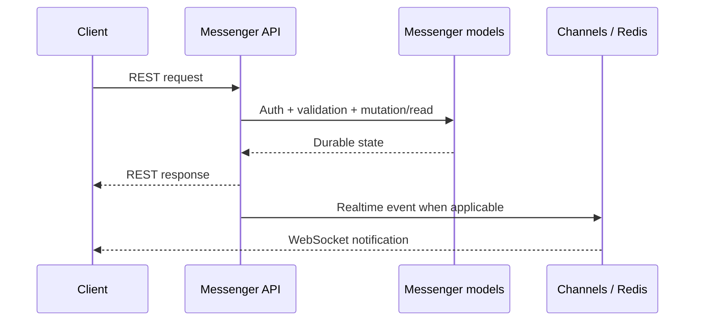
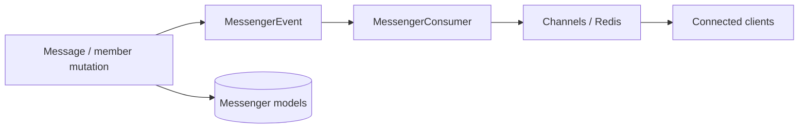

# messenger — detailed API reference

Root REST mount: `/api/messenger/`. This page is derived from the current route declarations and handler request access. Path identifiers are mandatory whenever present in the route.

## Architecture

The REST API owns authentication, object-level conversation/member authorization and durable model mutation. Realtime delivery is a transport layer; it is not the durable source of truth.

The topic route is implemented in `src/messenger/api/topics.py`: standard groups create ordinary child conversations; an encrypted group creates a client-side Matrix encrypted room and registers it through the secure path. The Matrix endpoints are in `src/messenger/api/matrix.py`; they accept only authenticated contacts/authorized participants and do not return the Synapse admin token. Secure rooms use Matrix for encrypted text, while the current release explicitly disables legacy attachment, search, scheduled, forwarding, reaction, read-receipt and call features.

## Route and behavior source of truth

The route-by-route matrix is maintained in [messenger API](api.md#exact-http-surface). That page records the method, exact URL, handler purpose, security constraints and side effects for each public endpoint, including contacts, group management, topic conversations, messages, media, view-once attachments, calls and optional Matrix routes.

This page intentionally does not repeat a module-wide set of request keys beside every URL. A key read by one handler is not a parameter for every handler in the same Python file. For operation-specific payloads, follow the exact route's handler in `src/messenger/api/` and its serializer. The request rules below are shared conventions, not a substitute for endpoint-specific validation.

## Required vs optional input rules

- Path identifiers are always required when present in the URL: conversation id, message id, user id, invite-link id, join-request id and attachment id.
- Query parameters are optional unless the operation explicitly rejects a missing value. Search/filter endpoints generally treat omission as an unfiltered request.
- Body fields are operation-specific. A field listed as "observed" above is not automatically required; the handler/serializer decides requiredness.
- For exact create/update validation, use the corresponding serializer/domain function as the final contract.

## Main operation groups

### Conversations
Conversation operations validate membership and role before mutation. Conversation creation/update may include title/description/publicity/approval and member-policy fields depending on the handler. Parent conversation ids in detail routes are mandatory.

### Messages
Message creation/edit/reaction/pin/read/forward operations act on a concrete conversation/message id and retain server-side authorization. Scheduling endpoints add scheduled-time/cancellation semantics. A client id, where supported, is correlation metadata and is not the database primary key.

### Groups and join requests
Group search/join and join-request approval are separate flows. The approval endpoint is addressed by both conversation id and request id. A requester can cancel their own pending request through the dedicated route.

### Invite links
Invite links are conversation-scoped. Revoke requires the conversation id and link id. Joining by code uses the code as a path value.

### Media and profile
Attachment delivery is access-controlled before streaming. View-once media has an explicit one-time-open state. Profile operations target the caller's own profile unless an explicit admin boundary is used.

### Calls
Call state is conversation-scoped. Active-call and join operations read current state; ending a call is a mutation guarded by call/session authorization.

## Realtime and durability

A client should be able to recover from a missed WebSocket event by reading the relevant REST resource again.

## Security invariants

1. Authentication does not imply conversation/object access.
2. Membership and role checks are server-side.
3. Attachment access is checked before content delivery.
4. Realtime events do not replace durable DB writes.
5. User-owned profile actions do not become cross-user mutations without an explicit admin boundary.

## Source

`src/messenger/urls.py` and `src/messenger/api/*.py`.
